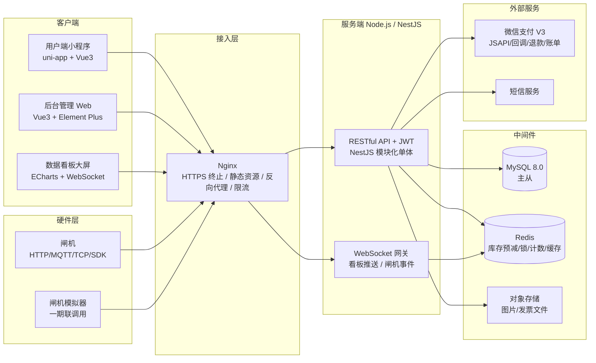
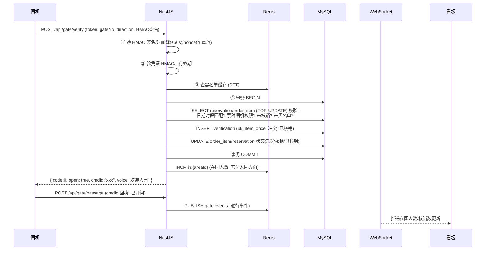
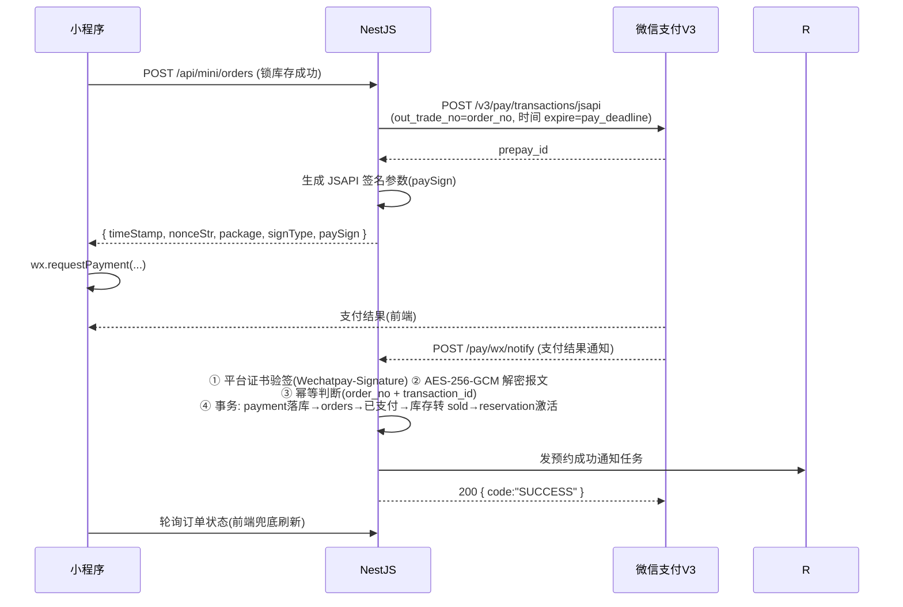
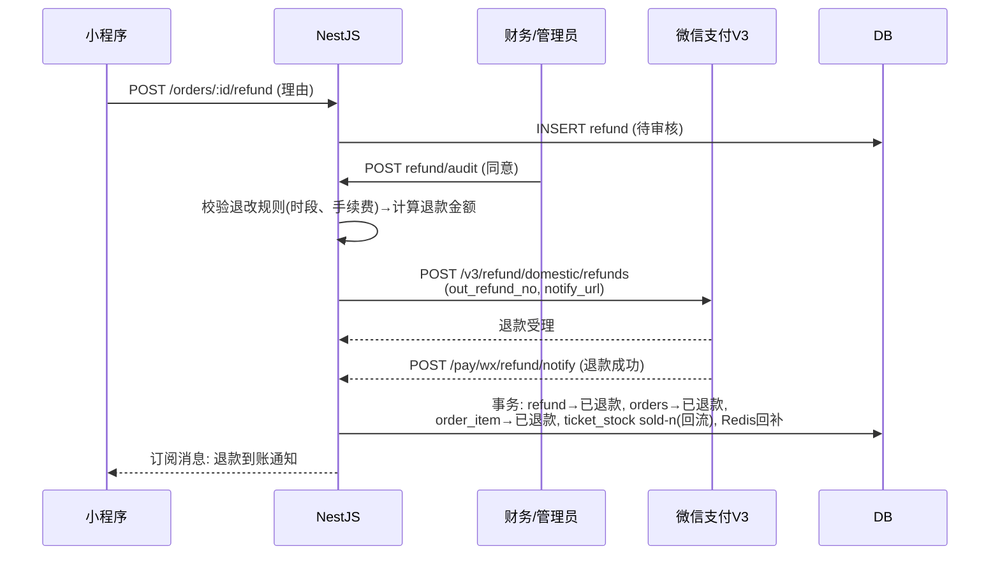

# 景区预约管理及门禁联动系统 技术方案设计

| 项目     | 内容                                       |
| -------- | ------------------------------------------ |
| 文档类型 | 技术方案设计（概要设计 + 关键详细设计）   |
| 版本     | V1.0                                       |
| 依据     | 《景区预约管理及门禁联动系统 PRD》V1.0     |
| 一期范围 | 小程序预约/微信支付/订单/凭证 + 后台管理 + 基础闸机 HTTP 联动 |
| 支付方式 | 一期即接入真实微信支付（JSAPI 小程序支付） |

---

## 1. 总体架构

### 1.1 架构图



### 1.2 架构决策

| 决策点        | 选择                   | 理由                                                                 |
| ------------- | ---------------------- | -------------------------------------------------------------------- |
| 服务形态      | **NestJS 模块化单体**  | 一期团队规模和并发（1000+）单体 + 水平扩展足够；模块边界即未来微服务边界，按 `scenic / ticket / order / pay / verify / gate / stats / admin` 划分模块 |
| 框架          | NestJS（非 Express 裸写） | 自带 DI、模块化、Guard（RBAC）、Swagger 集成，匹配 PRD 的 RBAC + 接口文档要求 |
| 消息队列      | 一期用 **Redis Stream** | RabbitMQ/Kafka 一期非必需；核销事件、看板刷新、对账任务用 Redis Stream 解耦，二期流量上来可无痛换 RabbitMQ |
| 实时通信      | 服务端 **WebSocket**（`ws` 库 / `@nestjs/websockets`） | 看板 <5s 延迟要求；闸机事件（心跳、告警、通行）同时通过 WS 推给看板和运维端 |
| 闸机对接      | 一期 **HTTP/JSON + 签名**，抽象 `GateAdapter` 适配层 | PRD 风险应对明确要求设备适配层；一期用模拟器联调，真机到场只写新 Adapter |
| 秒级凭证      | **HMAC 签名 Token 二维码** | 满足每分钟刷新、防截屏、防重放、支持闸机离线本地验签（见 §5.2） |
| 部署          | Docker Compose（云服务器 + Nginx） | 一期不上 K8s，单机 compose 即可；二期扩容时再迁移 |

### 1.3 Monorepo 项目结构

```
attraction-booking/
├── server/                    # NestJS 服务端
│   ├── src/
│   │   ├── modules/
│   │   │   ├── auth/          # 登录、JWT、RBAC Guard
│   │   │   ├── scenic/        # 景区、公告、须知
│   │   │   ├── ticket/        # 票种、时段、价格日历、库存
│   │   │   ├── order/         # 订单、状态机、限购
│   │   │   ├── pay/           # 微信支付、回调、退款、对账单
│   │   │   ├── reservation/   # 预约、凭证 Token、改签
│   │   │   ├── verify/        # 核销（含幂等、防重）
│   │   │   ├── gate/          # 闸机适配层、核验、心跳、通行、告警
│   │   │   ├── stats/         # 客流统计、日统计、看板数据
│   │   │   ├── admin/         # 管理端：用户、角色、日志、参数
│   │   │   └── notify/        # 消息、短信、小程序订阅消息
│   │   ├── common/            # 拦截器、过滤器、装饰器、工具
│   │   └── jobs/              # 定时任务：超时取消、对账、统计聚合
│   ├── test/
│   └── package.json
├── admin-web/                 # 后台管理 Vue3 + Vite + Element Plus
├── miniprogram/               # 用户端 uni-app（Vue3+Vite+TS，页面与样式由 scripts/ 生成器产出）
├── dashboard/                 # 数据看板（可并入 admin-web，独立大屏路由）
├── gate-simulator/            # 闸机模拟器（Node.js CLI / 简单 Web UI）
├── deploy/                    # docker-compose.yml、nginx.conf、init.sql
└── docs/                      # PRD、本设计文档、接口文档、部署文档
```

> 看板不单独建工程：作为 `admin-web` 的 `/dashboard/bigscreen` 路由（全屏组件），PRD 的"数据看板"端即此路由投屏，减少一个工程的维护成本。

---

## 2. 数据库设计

在 PRD 第 7 节基础上补全缺失表（支付流水、退款单、价格日历、时段配置、库存调整日志、改签记录、离线同步、操作日志），并修正动态二维码不应落静态 `qr_code` 字段的问题。

通用约定：

- 主键 `id BIGINT UNSIGNED AUTO_INCREMENT`
- 所有表带 `created_at / updated_at DATETIME`
- 身份证、手机号**加密存储**（AES-256-GCM，密钥在环境变量/KMS），日志展示层脱敏
- 字符集 `utf8mb4`，引擎 InnoDB
- 金额单位**分**（`INT`），避免浮点误差

### 2.1 表清单（23 张）

| 分组 | 表名                | 说明 |
| ---- | ------------------- | ---- |
| 用户 | `user`              | 小程序用户 |
| 用户 | `visitor`           | 游客/同行人（实名信息） |
| 景区 | `scenic_area`       | 景区 |
| 景区 | `announcement`      | 公告 |
| 票务 | `ticket_type`       | 票种 |
| 票务 | `time_slot`         | 时段定义（08:00-10:00） |
| 票务 | `price_calendar`     | 日期维度的价格（平日/周末/节假日） |
| 票务 | `ticket_stock`       | 分时库存（票种 × 日期 × 时段） |
| 票务 | `stock_change_log`   | 库存手工调整日志 |
| 票务 | `purchase_rule`      | 限购规则（票种级） |
| 交易 | `orders`            | 订单主表（`order` 是 MySQL 保留字风险，改名 orders） |
| 交易 | `order_item`        | 订单明细（每位游客一行，支撑部分核销） |
| 交易 | `payment`           | 支付流水（微信支付单号、回调原文） |
| 交易 | `refund`            | 退款单（审核人、原因、原路退回流水） |
| 交易 | `reschedule`        | 改签记录 |
| 预约 | `reservation`       | 预约单（订单 × 日期 × 时段） |
| 核销 | `verification`      | 核销记录（唯一索引防重） |
| 通行 | `passage_record`     | 通行记录 |
| 闸机 | `gate_device`        | 闸机设备 |
| 闸机 | `gate_log`           | 闸机通信日志 |
| 闸机 | `gate_command`       | 下行指令（开闸/常开/重启，含状态回执） |
| 闸机 | `offline_sync_record`| 离线记录同步与冲突处理 |
| 风控 | `blacklist`          | 黑名单 |
| 管理 | `admin_user`         | 管理员 |
| 管理 | `role` / `admin_role` / `role_permission` | 角色与 RBAC |
| 管理 | `operation_log`      | 操作日志（append-only） |
| 管理 | `sys_config`         | 参数配置（预约规则、预警阈值） |
| 告警 | `alarm`              | 告警 |
| 统计 | `daily_stats`        | 日统计 |
| 统计 | `hourly_stats`       | 分时统计（看板趋势、对账基础） |

### 2.2 核心表结构（DDL 摘要）

```sql
-- 库存表：防超卖核心，sold/locked 与 total 的一致性由乐观锁保证
CREATE TABLE ticket_stock (
  id            BIGINT UNSIGNED AUTO_INCREMENT PRIMARY KEY,
  scenic_area_id  BIGINT UNSIGNED NOT NULL,
  ticket_type_id BIGINT UNSIGNED NOT NULL,
  date          DATE NOT NULL,
  time_slot_id  BIGINT UNSIGNED NOT NULL,
  total         INT NOT NULL,           -- 总库存
  sold          INT NOT NULL DEFAULT 0, -- 已售（已支付确认）
  locked        INT NOT NULL DEFAULT 0, -- 下单锁定（待支付）
  UNIQUE KEY uk_ticket_date_slot (ticket_type_id, date, time_slot_id)
) ENGINE=InnoDB;

-- 订单主表
CREATE TABLE orders (
  id            BIGINT UNSIGNED AUTO_INCREMENT PRIMARY KEY,
  order_no      VARCHAR(32) NOT NULL,   -- 业务单号 (YYYYMMDD+景区+雪花)
  user_id       BIGINT UNSIGNED NOT NULL,
  scenic_area_id  BIGINT UNSIGNED NOT NULL,
  reservation_id BIGINT UNSIGNED NOT NULL,
  amount        INT NOT NULL,           -- 分
  status        TINYINT NOT NULL,       -- 状态机枚举
  channel       VARCHAR(16) NOT NULL DEFAULT 'mini',  -- mini/ota/window
  pay_deadline  DATETIME NOT NULL,      -- 支付截止（下单+15min）
  pay_time      DATETIME NULL,
  UNIQUE KEY uk_order_no (order_no),
  KEY idx_user_status (user_id, status),
  KEY idx_area_date (scenic_area_id, created_at)
) ENGINE=InnoDB;

-- 订单明细：每个游客一行，status 独立，支撑"部分核销"
CREATE TABLE order_item (
  id            BIGINT UNSIGNED AUTO_INCREMENT PRIMARY KEY,
  order_id      BIGINT UNSIGNED NOT NULL,
  visitor_id    BIGINT UNSIGNED NOT NULL,
  ticket_type_id BIGINT UNSIGNED NOT NULL,
  price         INT NOT NULL,           -- 成交价（快照，来自价格日历）
  status        TINYINT NOT NULL,        -- 待核销/已核销/已退款
  UNIQUE KEY uk_order_visitor (order_id, visitor_id),
  KEY idx_visitor (visitor_id)
) ENGINE=InnoDB;

-- 预约表：去掉静态 qr_code，凭证由服务端实时签发 Token（§5.2）
CREATE TABLE reservation (
  id            BIGINT UNSIGNED AUTO_INCREMENT PRIMARY KEY,
  order_id      BIGINT UNSIGNED NOT NULL,
  scenic_area_id  BIGINT UNSIGNED NOT NULL,
  date          DATE NOT NULL,
  time_slot_id  BIGINT UNSIGNED NOT NULL,
  status        TINYINT NOT NULL,       -- 待使用/已使用/已取消/已过期/已改签
  verify_count  INT NOT NULL DEFAULT 0, -- 已核销人数
  total_count   INT NOT NULL,           -- 应核销人数
  KEY idx_order (order_id),
  KEY idx_area_date (scenic_area_id, date, time_slot_id),
  KEY idx_date_status (date, status)
) ENGINE=InnoDB;

-- 支付流水：对账基础表
CREATE TABLE payment (
  id            BIGINT UNSIGNED AUTO_INCREMENT PRIMARY KEY,
  order_id      BIGINT UNSIGNED NOT NULL,
  transaction_id VARCHAR(64) NULL,      -- 微信支付单号
  amount        INT NOT NULL,
  status        TINYINT NOT NULL,       -- 支付中/成功/失败/已关闭
  raw_callback  JSON NULL,             -- 回调报文存档
  callback_time DATETIME NULL,
  KEY idx_order (order_id),
  UNIQUE KEY uk_transaction (transaction_id)
) ENGINE=InnoDB;

-- 核销记录：唯一索引 = 幂等防线
CREATE TABLE verification (
  id            BIGINT UNSIGNED AUTO_INCREMENT PRIMARY KEY,
  reservation_id BIGINT UNSIGNED NOT NULL,
  order_item_id  BIGINT UNSIGNED NOT NULL,   -- 精确到人，支撑部分核销
  channel       VARCHAR(16) NOT NULL,        -- gate/pda/manual
  gate_id       BIGINT UNSIGNED NULL,
  operator_id   BIGINT UNSIGNED NULL,        -- 检票员（手动核销时）
  verify_time   DATETIME(3) NOT NULL,
  UNIQUE KEY uk_item_once (order_item_id),   -- 一人一票只能核销一次
  KEY idx_res (reservation_id)
) ENGINE=InnoDB;

-- 通行记录
CREATE TABLE passage_record (
  id            BIGINT UNSIGNED AUTO_INCREMENT PRIMARY KEY,
  reservation_id BIGINT UNSIGNED NULL,   -- 应急放行/尾随可能无预约
  gate_id       BIGINT UNSIGNED NOT NULL,
  credential     VARCHAR(64) NOT NULL,   -- 凭证摘要（脱敏）
  direction     TINYINT NOT NULL,        -- 1 入园 / 2 出园
  result        TINYINT NOT NULL,        -- 通过/拒绝/异常/应急放行
  reject_reason VARCHAR(32) NULL,
  passed_at     DATETIME(3) NOT NULL,
  KEY idx_gate_time (gate_id, passed_at),
  KEY idx_area_dir_time (scenic_area_id, direction, passed_at)  -- 冗余 area_id 列省略，实际表需带
) ENGINE=InnoDB;

-- 闸机设备
CREATE TABLE gate_device (
  id            BIGINT UNSIGNED AUTO_INCREMENT PRIMARY KEY,
  scenic_area_id  BIGINT UNSIGNED NOT NULL,
  gate_no       VARCHAR(32) NOT NULL,    -- 闸机编号
  name          VARCHAR(64) NOT NULL,
  location      VARCHAR(128) NULL,
  ip            VARCHAR(64) NULL,
  protocol      VARCHAR(16) NOT NULL DEFAULT 'http', -- http/mqtt/tcp/sdk
  direction     TINYINT NOT NULL,        -- 入/出/双向
  status        TINYINT NOT NULL,        -- 在线/离线/禁用/故障
  last_heartbeat DATETIME(3) NULL,
  secret_key    VARCHAR(128) NOT NULL,  -- 闸机级签名密钥（HTTP 互信）
  allowed_slots JSON NULL,              -- 通行规则：允许时段/票种（下行缓存）
  firmware_version VARCHAR(32) NULL,
  UNIQUE KEY uk_gate_no (gate_no)
) ENGINE=InnoDB;

-- 下行指令：开闸指令状态回执追踪
CREATE TABLE gate_command (
  id            BIGINT UNSIGNED AUTO_INCREMENT PRIMARY KEY,
  gate_id       BIGINT UNSIGNED NOT NULL,
  command_no    VARCHAR(64) NOT NULL,   -- 幂等键
  type          VARCHAR(16) NOT NULL,   -- open/hold_open/close/reboot
  status        TINYINT NOT NULL,       -- 下发/已执行/超时失败
  issued_by     BIGINT UNSIGNED NULL,
  sent_at       DATETIME(3) NOT NULL,
  ack_at        DATETIME(3) NULL,
  UNIQUE KEY uk_command_no (command_no)
) ENGINE=InnoDB;

-- 离线同步记录：冲突审核
CREATE TABLE offline_sync_record (
  id            BIGINT UNSIGNED AUTO_INCREMENT PRIMARY KEY,
  gate_id       BIGINT UNSIGNED NOT NULL,
  batch_no      VARCHAR(64) NOT NULL,
  payload       JSON NOT NULL,          -- 离线核销明细
  sync_status   TINYINT NOT NULL,       -- 待处理/已合并/冲突待审核
  conflict_note VARCHAR(255) NULL,
  synced_at     DATETIME NOT NULL,
  KEY idx_status (sync_status)
) ENGINE=InnoDB;

-- 操作日志：append-only，不提供 UPDATE/DELETE 接口
CREATE TABLE operation_log (
  id          BIGINT UNSIGNED AUTO_INCREMENT PRIMARY KEY,
  admin_id    BIGINT UNSIGNED NOT NULL,
  action      VARCHAR(64) NOT NULL,
  target_type VARCHAR(32) NULL,
  target_id   BIGINT UNSIGNED NULL,
  detail      JSON NULL,
  ip          VARCHAR(64) NULL,
  created_at  DATETIME(3) NOT NULL,
  KEY idx_admin_time (admin_id, created_at)
) ENGINE=InnoDB;
```

其余表（`user / visitor / scenic_area / announcement / ticket_type / time_slot / price_calendar / stock_change_log / purchase_rule / refund / reschedule / blacklist / admin_user / role / alarm / daily_stats / hourly_stats / sys_config`）按 PRD 字段加通用约定即可，DDL 在开发期随建表迁移文件交付（TypeORM Migration / SQL 文件双轨）。

### 2.3 状态机枚举（TINYINT 值域）

```
订单 orders.status:
  10 待支付 → 20 已支付待核销 → 30 部分核销 → 40 已核销
              ↘ 50 已取消(未支付/超时)   ↘ 60 已退款(全额)   70 已过期

预约 reservation.status:
  10 待使用 → 20 已使用 | 30 已取消 | 40 已过期 | 50 已改签(原单终态)

支付 payment.status:  1 支付中 → 2 成功 | 3 失败 | 4 已关闭
退款 refund.status:   10 待审核 → 20 退款中 → 30 已退款 | 40 已拒绝 | 50 退款失败(需人工)
通行 result:          1 通过 2 拒绝 3 异常 4 应急放行
```

**状态迁移只能通过各模块的状态机服务函数执行**（带前置状态校验的 `UPDATE ... WHERE status = <期望前置态>`），禁止散落的裸 UPDATE。

---

## 3. API 设计

### 3.1 总体规范

- 风格：RESTful，前缀 `/api`；三套入口 `/api/mini`（小程序）、`/api/admin`（后台）、`/api/gate`（闸机）
- 认证：
  - mini：JWT（`Authorization: Bearer`），openid 换发
  - admin：JWT + RBAC Guard（`@Roles('refund:audit')` 装饰器）
  - gate：**HMAC 签名**（见 §5.4），非 JWT——闸机无用户概念
- 统一响应体：`{ code: 0, msg: "ok", data: ... }`，业务错误码分段（1xxx 用户、2xxx 票务库存、3xxx 订单支付、4xxx 核销通行、5xxx 设备）
- 文档：NestJS `@nestjs/swagger` 自动生成 OpenAPI，Apifox 导入调试
- 限流：Nginx `limit_req` 粗控 + 应用内 Redis 令牌桶（登录/下单/核验接口细控）
- **多景区口径**：`/api/mini/areas` 返回所有**开放中**的景点，小程序端由用户选（`store` 里落盘）；
  后台统计类接口（`dashboard/realtime`、`dashboard/hourly`、`stats/daily`、`stats/rebuild`、
  `reconciliations/run`）**不传 `areaId` = 全部景点汇总**，传了就只算那一个。
  ⚠️ 汇总时「承载率」的分母是各景点 `max_capacity` **之和**（分子总在园 ÷ 分母总容量），
  不是「各景点承载率求平均」—— 后者会被小景点放大。
  ⚠️ 在园人数按景点分 Redis key（`presence:in|out:{areaId}:{date}`），汇总要遍历求和。
- **时间与「日历日」**：库表里的时间列一律存**绝对时刻**，查当天的数据用 `DATE(col)` 交给 MySQL
  （会话时区固定 `+08:00`）。而**应用侧**要「今天/昨天」这类**日历日**时，必须走
  `common/utils/date.util.ts` 的 `businessToday()` / `addDaysStr()` / `diffDays()` ——
  **不能用 `new Date().toISOString().slice(0,10)`**，那是 UTC：
  MySQL 与宿主机都是东八区，直接用 UTC 会让两者在**每天 00:00–08:00 差一天**
  （当天有效票被判「未到预约日期」、前一天的票反被放行；日结任务还会算成前天）。
  业务时区由 `BUSINESS_TZ` 指定（默认 `Asia/Shanghai`），须与 MySQL 的
  `--default-time-zone` 一致；`@Cron` 的触发时刻另按进程时区，也要保持一致。
  回归测试：`npm run smoke:date`（固定时刻 + 换进程时区重跑比对）。

### 3.2 小程序端（一期 P0）

| 方法 | 路径 | 说明 |
| ---- | ---- | ---- |
| POST | /api/mini/auth/login | code2session 换 openid，签发 JWT |
| GET  | /api/mini/areas/:id | 景区详情 + 公告 + 开放时间 |
| GET  | /api/mini/areas/:id/presence | 实时在园情况（首页「在园率」；口径与后台看板一致，以闸机通行回执为准） |
| GET  | /api/mini/tickets?areaId=&date= | 票种列表 + 当日价格（读价格日历），含 `saleUnit` 计价单位 |
| GET  | /api/mini/stocks?ticketTypeId=&date= | 分时余票（Redis 缓存，1s 过期） |
| POST | /api/mini/orders | 创建订单（预检限购 + 锁库存，返回支付参数） |
| GET  | /api/mini/orders | 订单列表（分页、状态筛选） |
| GET  | /api/mini/orders/:id | 订单详情 |
| POST | /api/mini/orders/:id/cancel | 取消订单（释放库存） |
| GET  | /api/mini/orders/:id/credential | 获取动态凭证 Token（60s 有效） |
| POST | /api/mini/orders/:id/refund | 申请退款 |
| GET  | /api/mini/visitors | 常用游客列表 |
| POST | /api/mini/visitors | 添加/编辑同行人（身份证校验位验真） |

> 以上 12 个接口**已全部实现**。在此之外另补了四个：
>
> - `PUT|DELETE /api/mini/visitors/:id` —— 支撑个人中心的「管理」入口。
>   删除对**已被 `order_item` 引用**的出行人会拒绝（400）：`order_item` 只存 `visitor_id`、
>   不快照姓名与证件，硬删会让历史订单详情丢掉持票人。
> - `GET /api/mini/areas/:id/presence` —— 首页「在园率」。复用 `PresenceService` 与
>   `scenic_area.max_capacity`，**口径与 `StatsService.dashboard` 完全一致**（冒烟里直接比对两者）。
> - `GET /api/mini/platform/settings` —— 平台品牌与联系方式（顶栏名称/英文名/副标题、客服电话、版本号），
>   **免登录**，读的是 `sys_config.platform`。后台「参数配置」页改了它，小程序下次启动就跟着变
>   —— 品牌名不再是设计稿里写死的字面量，也不需要发版。
>
> ⚠️ **计价单位（`ticket_type.sale_unit`）**：本系统目前**只有「按人计价」一种模型** ——
> `order.service.ts` 是硬编码的 `金额 = 单价 × 人数`，每位游客一条 `order_item`。
> `/tickets` 因此返回 `saleUnit`（`person` / `ticket`），客户端把 `ticket` 的票种
> **拦在购票流程外**（提示「暂不支持在线预约」），避免「¥388/张」的年卡被按人数算成 ¥388 × N。
> 完整支持按张（数量选择 UI + 计价模型）尚未实现。
>
> ⚠️ **订单列表与详情另带了退款信息**：`refundStatus`（列表）与 `refund`（详情，含
> `status`/`amount`/`fee`/`actualAmount`/`reason`/`auditRemark`）。因为
> **申请退款不改订单状态**（仍是 20/30），只多一条待审的 `refund` 记录 ——
> 没有这两个字段，客户端无法显示「退款审核中 / 已拒绝」。列表另带 `ticketName`
> （否则列表只有 `itemCount`，卡片说不出买的是什么票）。
>
> ⚠️ **退款准入已收紧为「仅已支付(20)」**。原先 `PARTIAL_VERIFIED(30)` 也放行，但退款金额按
> **整单 `order.amount`** 算、不看已核销人数 —— 2 人单核销 1 人后能整单全额退，
> 会把已经消费掉的那张票的钱也退掉。

### 3.3 管理端（一期 P0，节选）

| 方法 | 路径 | 说明 |
| ---- | ---- | ---- |
| POST | /api/admin/auth/login | 账号密码登录（bcrypt + 失败锁定） |
| GET/POST/PUT | /api/admin/scenic/** | 景区/公告/须知 |
| GET/POST/PUT | /api/admin/ticket-types/** | 票种、时段、价格日历 |
| GET/PUT | /api/admin/stocks/:id | 库存查询/手动调整（写 stock_change_log） |
| GET  | /api/admin/orders | 订单列表（多条件筛选、导出 CSV） |
| POST | /api/admin/orders/:id/refund/audit | 退款审核（同意→调微信退款，拒绝→回备注） |
| POST | /api/admin/verify | 扫码/手动核销（PDA 同此接口） |
| GET  | /api/admin/gates | 闸机列表 + 状态 |
| POST | /api/admin/gates/:id/command | 远程开闸/常开/常闭/重启（写 gate_command） |
| GET  | /api/admin/dashboard/realtime | 工作台实时数据 |
| GET  | /api/admin/stats/daily | 日统计 |
| GET/POST | /api/admin/roles/** | 角色/权限维护 |
| GET  | /api/admin/logs/operations | 操作日志查询 |

### 3.4 闸机接口（HTTP/JSON + HMAC 签名，一期）

| 方法 | 路径 | 说明 |
| ---- | ---- | ---- |
| POST | /api/gate/verify | 凭证核验 → 返回开闸指令（§5.3） |
| POST | /api/gate/heartbeat | 心跳（30s 间隔，返回规则/名单增量版本号） |
| POST | /api/gate/passage | 通行结果上报（开闸后回执 + 出园上报） |
| POST | /api/gate/alarm | 告警上报（尾随/强闯/消防） |
| POST | /api/gate/offline/sync | 离线记录批量上传（§5.5） |
| GET  | /api/gate/rules | 全量拉取缓存规则（白名单/黑名单/票种规则/密钥版本） |

### 3.5 微信支付回调（服务端接收，不经过 `/api` 前缀网关限流）

| 方法 | 路径 | 说明 |
| ---- | ---- | ---- |
| POST | /pay/wx/notify | 支付结果通知（V3 平台证书验签 + 报文解密） |
| POST | /pay/wx/refund/notify | 退款结果通知 |

---

## 4. 关键技术方案一：防超卖（下单-支付-取消链路）

目标：1000+ 并发下零超卖、不少卖（超卖业务事故，少卖是收入损失），库存最终与订单严格一致。

### 4.1 三段式库存模型

```
total = sold + locked + available(不动账) 
available = total - sold - locked
```

- **下单**：`locked + n`（锁库存）
- **支付成功回调**：`locked - n, sold + n`（转已售）
- **取消/超时**：`locked - n`（释放）
- **退款成功**：`sold - n`（回流，视退改规则）

### 4.2 下单流程（时序）

```mermaid
sequenceDiagram
    participant MP as 小程序
    participant API as NestJS
    participant R as Redis
    participant DB as MySQL

    MP->>API: POST /orders (票种/日期/时段/游客列表)
    API->>API: 参数校验、限购预检(账号+身份证, 查 Redis 计数)
    API->>R: Lua 预减 lock:{stockKey} (原子: 可用>=n ? 扣减 : 返回不足)
    Note on R: 预减成功 = 拿到"占位资格"
    API->>DB: BEGIN
    API->>DB: UPDATE ticket_stock SET locked=locked+n<br/>WHERE id=? AND total-sold-locked>=n  (乐观锁, 影响行数=0 则回滚)
    API->>DB: INSERT orders / order_item / reservation (status=待支付)
    API->>DB: COMMIT
    API->>R: INCR 限购计数、EXPIRE
    API-->>MP: 返回订单 + JSAPI 支付参数
    Note over API: 若 DB 失败 → Redis Lua 补偿回滚预减
```

要点：

1. **Redis Lua 预减**拦截 99% 的超卖请求（库存不足直接快速失败，DB 无压力）：
   ```lua
   -- KEYS[1]=lock:stock:{stockId}  ARGV[1]=n
   local avail = tonumber(redis.call('GET', KEYS[1]) or -1)
   if avail == -1 then return -2 end        -- 缓存缺失，触发回源重建
   if avail < tonumber(ARGV[1]) then return -1 end
   redis.call('DECRBY', KEYS[1], ARGV[1])
   return avail - tonumber(ARGV[1])
   ```
   `lock:stock:{stockId}` 由 `total - sold - locked` 初始化，**订单取消/退款/库存调整时同步回补**；缓存缺失时用 Redis 分布式锁回源 DB 重建（防止初始化与回补并发覆盖）。
2. **MySQL 乐观锁兜底**：`WHERE total-sold-locked >= n` 是最终防线，即使 Redis 数据漂移也不会超卖。
3. **支付成功回调**（§6.3）在同一事务内完成 `locked-n, sold+n` + 订单状态迁移 + 支付流水落库，事务外发通知。

### 4.3 超时取消与库存回补

- 下单时写 `pay_deadline = now + 15min`；
- 定时任务（BullMQ repeatable job，每 30s 扫描）：`SELECT ... WHERE status=待支付 AND pay_deadline < NOW() LIMIT 200` → 逐单状态机取消 → 释放 locked（MySQL）+ 回补 Redis；
- 兜底：微信 `查询订单` 主动查单（防"已支付但回调丢失"，先查单再取消）；
- 对账任务（每日凌晨 + 每小时增量）：`Σ(order_item 已支付票数) == Σ(ticket_stock.sold)`，不平则告警 + 生成差异清单人工处理（PRD 10 要求）。

### 4.4 限购规则

`purchase_rule`（票种级）：`{ "perUserPerDay": 5, "perUserPerOrder": 4, "perIdCardPerDay": 1 }`。
计数用 Redis `pf:{userId}:{ticketTypeId}:{date}`，**DB 层再以 `SELECT COUNT` 复核**（Redis 只是加速，防刷绕过以 DB 为准；下单事务内 count + insert，靠行锁串行化）。

---

## 5. 关键技术方案二：动态凭证、核验核销与闸机联动

### 5.1 凭证 Token 设计（动态二维码）

二维码内容 = 签名 Token 字符串：

```
payload = { rid: 预约id, uid: 用户id, exp: 当前分钟+60s, nonce: 8字节随机 }
token   = base64url(payload) + "." + base64url(HMAC-SHA256(payload, CRED_SECRET_v{n}))
```

- **60 秒有效**（按分钟取整），小程序端每 50s 自动刷新（防截屏：截屏图 60s 后自然失效，无需复杂防截屏检测）；
- `CRED_SECRET` 定期轮换（版本号 v{n}），旧版本 24h 内同时有效，支持发新密钥给闸机；
- 同一 token 在有效期内**可被多次出示**（核销幂等由服务端防重），但同一游客只能核销一次（`verification.uk_item_once`）。

### 5.2 闸机离线验签（二期完整实现，一期留接口）

- 闸机通过 `/api/gate/rules` + 心跳增量同步三样东西：**当前 CRED_SECRET、当日预约白名单（预约号+身份证哈希+时段）、黑名单**；
- 断网时闸机本地 HMAC 验签 + 白名单匹配 → 本地放行并记录 → 恢复后 `/api/gate/offline/sync` 上传；
- 服务端冲突规则（PRD 6.4.4）：**以首次核销为准**——离线记录中已被在线核销过的（`order_item` 已核销）标记冲突，进 `offline_sync_record` 待人工审核，绝不重复计数。

### 5.3 核验与开闸流程（核心时序，目标 <500ms 核验、<1s 开闸）



关键设计：

1. **幂等三重防线**：
   - 请求层：HMAC nonce 缓存 5 分钟，重放直接拒绝；
   - 指令层：返回 `cmdId`（服务端生成、`gate_command` 落库），闸机以 cmdId 去重——同一 cmdId 的重复 verify 响应不二次开闸；
   - 数据层：`verification(order_item_id)` 唯一索引，事务内 insert 冲突即"重复核销"→ 返回特殊错误码 + 触发告警事件（PRD A-033）。
2. **拒绝可解释**：错误码区分 `过期/时段不符/已核销/黑名单/闸机无权限/签名错误`，闸机屏幕/语音按码提示。
3. **性能**：核验路径只做 1 次 DB 事务（2 读 2 写），黑名单/规则走 Redis 缓存，单机可轻松 <100ms；开闸指令超时 3s 未收到 passage 回执 → `gate_command` 标记超时 + 产生告警（PRD 6.4.3）。

### 5.4 闸机 HTTP 请求签名（防伪造/重放）

```
headers:
  X-Gate-No: GATE001
  X-Timestamp: 1728360000000     # ±60s 容差
  X-Nonce: 16字节随机
  X-Signature: HMAC-SHA256(gate.secret_key, method + path + timestamp + nonce + body)
```

- `secret_key` 每台闸机独立，后台可重置；
- nonce 存 Redis `SETNX key nonce EX 120`，命中即拒绝；
- Nginx 层对 `/api/gate/*` 不限流为单一 IP 突发（按 gate_no 限流），防闸机重试风暴。

### 5.5 远程控制与应急放行

- `/api/admin/gates/:id/command` → 写 `gate_command` → HTTP 下发（闸机常连场景走 WS 通道下发）→ 回执更新状态；
- **应急放行**（消防/突发）：`type=hold_open` 常开，闸机上报消防信号时也可本地直接常开并上报告警（常开优先原则，PRD 13）；所有应急放行以 `passage_record(result=应急放行)` 记账，保证在园人数不漂移。

### 5.6 闸机适配层（GateAdapter）

```typescript
interface GateAdapter {
  protocol: 'http' | 'mqtt' | 'tcp' | 'sdk';
  verify(payload: VerifyRequest): Promise<VerifyResult>;   // 上行统一
  sendCommand(device: GateDevice, cmd: GateCommand): Promise<void>;  // 下行
  normalizeAlarm(raw: unknown): AlarmEvent;               // 告警归一化
}
```

一期实现 `HttpAdapter` + `gate-simulator`；真机到场后按厂商协议增加 Adapter，注册到 `GateRegistry`，业务代码零改动（对应 PRD 风险表"抽象设备适配层"）。

### 5.7 在园人数与客流统计

- 实时值：Redis `IN:{areaId}` / `OUT:{areaId}` 当日计数器，看板直读（<5s 延迟达标）；
- 落库：`passage_record` 插入后异步（Redis Stream 消费者）聚合写 `hourly_stats`；
- 校准：每 5 分钟任务以 `COUNT(passage_record)` 与 Redis 计数核对并覆盖修正；每日凌晨固化 `daily_stats`；
- 承载率预警：定时任务每 60s 检查 `在园/最大承载量`，达 80%/90%/100% 分级产生 `alarm` + WS 推送（PRD 6.3.3）。
  三档**阈值本身**（`{warn, serious, critical}`）来自 `sys_config.capacity_alarm`，后台「参数配置」可改，
  任务**每次运行读一遍**，所以改完最多 1 分钟生效。等级表由 `common/utils/capacity.util.ts` 的
  `buildCapacityLevels()` 构建，**顺序是高等级在前**（任务命中即 `break`，只报最高一档）。

---

## 6. 微信支付集成方案（V3 API，一期真实接入）

### 6.1 前置资质

- 微付商户号（mchid）+ 商户 API 证书（`apiclient_cert.pem` / `apiclient_key.pem`）
- 小程序 AppID 与商户号绑定
- 回调域名备案 + HTTPS 证书（Nginx 统一终止）
- 服务器需能访问 `api.mch.weixin.qq.com`（出口 IP 白名单按商户平台要求）

### 6.2 支付流程（JSAPI 小程序支付）



要点：

1. **下单即预支付**：`POST /orders` 成功后直接返回 JSAPI 参数，减少一次往返（支付参数有效期对齐 `pay_deadline`）；
2. **回调幂等**：微信会重复通知，以 `payment(order_id + status=成功)` 判断，重复通知直接回 200；
3. **回调不可达兜底**：每 5 分钟任务扫描"待支付且 10min < created < pay_deadline"的订单调 `/v3/pay/transactions/out-trade-no/{no}` 主动查单，"用户已支付但回调丢失"以查单结果补偿（对应 §4.3）；
4. **证书轮换**：平台证书自动下载更新（微信 V3 特性），不留硬编码。

### 6.3 退款流程



- 退改规则：`sys_config.refund` 是**全局兜底**，键名与 `ticket_type.refund_rule` **同一套**
  （`{ beforeDay, feeRate, expiredNoRefund }`：提前 `beforeDay` 天及以上申请免手续费，落在窗口内按
  `feeRate` 收手续费，`expiredNoRefund` 决定过期后是否一律不退）。票种自身的规则**按字段覆盖**全局 ——
  只设了 `feeRate` 的票种仍继承全局的 `beforeDay`。默认值「提前 1 天 0 手续费、当天 20%、已过期不退」。
  ⚠️ 两套键名曾经不一致（种子写 `beforeDayFeeRate`/`sameDayFeeRate`，代码读 `beforeDay`/`feeRate`），
  于是「后台改了不生效」；`seed.ts` 里有一段**守卫旧键存在**的一次性迁移负责归一，断言见 `npm run smoke:config`；
- 退款审核工作台在后台"订单管理→退款审核"（PRD A-022），操作全部写 `operation_log`；
- **退款失败**（微信侧余额不足等）→ `refund.status=退款失败` → 告警 → 人工处理。

### 6.4 支付对账

- 每日 09:00 拉取前一日微信 `交易账单` + `退款账单`（`/v3/bill/tradebook`、`/v3/refund/domestic/refunds` 的账单文件，GZIP 解压解析）；
- 三方核对：`payment/refund 流水` vs `微信账单` vs `orders 金额`；
- 差异写对账报告 + 告警（PRD A-062、KPI 99.9% 一致率的度量来源）。

---

## 7. 安全设计落地

| PRD 要求 | 本方案实现 |
| -------- | ---------- |
| HTTPS 全站 | Nginx 统一证书，HTTP 301 |
| JWT + RBAC | mini/admin 双 JWT 体系（不同 secret、不同过期）；RBAC = role → permission 字符串集，Guard 校验 + 菜单按权限返回 |
| 动态二维码防截屏/重放 | §5.1 60s Token；nonce 只在核验请求签名层防重放 |
| 身份证/手机号脱敏 | AES-256-GCM 加密落库；展示层 `110***********1234`；解密仅在核验匹配（哈希比对：核验只比 SHA256(id_card + salt)，不还原明文） |
| 接口签名/限流/防刷 | 闸机 HMAC（§5.4）；下单接口：图形验证码开关（sys_config）+ 令牌桶 + 限购（§4.4） |
| 操作日志不可篡改 | append-only 表 + 无更新接口 + 每日归档校验（二期可加哈希链） |
| 个人信息合规 | 提供《隐私政策》勾选、证件信息可删除（注销）、导出审计；人脸数据三期前不采集 |

---

## 8. 非功能设计

### 8.1 性能

- 库存热点：Redis 预减（§4.2），DB 只有乐观锁兜底写；
- 读多写少接口（票种、余票、景区详情）：Redis 缓存 + 失效更新；
- 看板：Redis 计数直读 + WS 增量推送，不聚合查库；
- 预约并发 1000+：单体 2 实例 + Nginx 负载均衡即可支撑（压测验证：`k6` 脚本随交付，见 `server/loadtest/`）。
  实测（**单实例**，生产构建）：1000 并发下单 1000/1000 成功、零超卖零 5xx；防超卖探针
  「1000 人抢 100 张」恰好锁 100 张；核验 P95 433–497ms（300 并发刷码）、
  开闸链路 P95 673–844ms。**单实例下单吞吐受单个热点库存行的 InnoDB 行锁限制**
  （所有买家同一时段时约 115 QPS，分散到 5 个时段约 283 QPS），
  高峰开票应把库存分摊到更多时段；横向扩实例可近似线性提升。

### 8.2 可用性与降级

- 闸机离线可用（§5.2）；
- Redis 故障：库存接口降级为**纯 MySQL 乐观锁**模式（性能下降但零超卖）；
- 看板推送故障：前端自动降级为 10s 轮询 REST 接口；
- **核销优先**：核心事务（订单/支付回调/核验）不依赖任何可降级组件之外的服务。

### 8.3 部署（一期 Docker Compose）

```yaml
services:
  nginx:      # 443 TLS、静态资源(admin-web dist)、反代 server、限流
  server:     # NestJS ×2 实例（compose scale）
  mysql:      # 主库（二期加从库）
  redis:      # AOF everysec
```

- 环境：开发（docker-compose dev + 热重载）/ 生产（compose + 云服务器）
- 备份：mysqldump 每日全量 + binlog；恢复演练文档随部署文档交付
- 配置管理：`.env`（开发）/ 云平台环境变量（生产），密钥不入库不入 git

---

## 9. 一期里程碑（对应 PRD 12 节 6-8 周，按 2 周一个迭代）

| 迭代 | 内容 | 出口标准 |
| ---- | ---- | -------- |
| M1 (W1-2) | 工程骨架、DB 迁移、认证/权限、景区/票种/时段/价格日历/库存 CRUD、闸机模拟器雏形 | ✅ 服务端完成：32 表落库、25 项冒烟断言全通过、Swagger 可调试；admin-web 界面待建 |
| M2 (W3-4) | 下单（Redis 预减+乐观锁）、微信支付 JSAPI + 回调 + 查单补偿、超时取消、退款申请/审核 | ✅ 服务端完成：M2 冒烟 28/28（含并发 6 单抢 3 库存零超卖）；admin-web 订单/退款页面待建。微信支付当前为本地 mock 模式（无商户证书文件），置 `WXPAY_MOCK=false` 即切真实支付 |
| M3 (W5-6) | 动态凭证、闸机核验/开闸/心跳/通行上报、扫码/手动核销、部分核销、在园人数与工作台 | ✅ 服务端完成：M3 冒烟 33/33；闸机接口按真实协议实现（HMAC 验签 + nonce 防重放 + cmdId 幂等），由 `gate-simulator` CLI 驱动，实测扫码→核验→开闸 39ms；重复核销告警与离线冲突处理生效。admin-web 页面待建 |
| M4 (W7-8) | 数据看板、日/时统计、告警中心、操作日志、导出、部署文档、压测与验收测试报告 | ✅ 已完成：运营分析、报表导出、三方对账、备份、承载预警；部署/操作/测试三份文档已交付；k6 压测脚本随交付（`server/loadtest/`，实测 1000 并发零超卖、核验 P95 < 500ms、开闸 P95 < 1s，并暴露修复 3 个并发缺陷）。PRD 验收标准 1-4、6-9 达成，第 5 项（闸机离线真机）待真机联调 |

二期（看板增强、离线核销、对账自动化、OTA）在一期架构上无结构性改动，均为模块内迭代。

---

## 10. 遗留决策与风险跟踪

| 事项 | 状态 | 说明 |
| ---- | ---- | ---- |
| 微信支付商户资质 | ✅ 已就绪 | 商户号、API 证书、小程序与商户绑定已具备，M2 真实支付无阻塞 |
| 闸机选型 | 非阻塞 | 一期用模拟器；真机需确认支持 HTTP/MQTT + 本地缓存能力（影响 §5.2 离线方案落地） |
| 出园核验 | 建议一期实现 | 出园不核验则在园人数靠单侧计数不准；一期出园闸机至少做"计数不放行校验" |
| 短信服务商 | 非阻塞 | 一期通知走小程序订阅消息，短信可后置 |
| 单/多景区 | **已实现** | 表结构本就按多景区设计（票种/时段/库存/订单/预约/闸机都带 `scenic_area_id`）；小程序端已有「选择景点」页、后台看板可选单个景点或**全部景点汇总**。「按省/市组织」与「后台其余页面按景点筛」仍待做 —— 见 `CLAUDE.md` 当前进度 |
