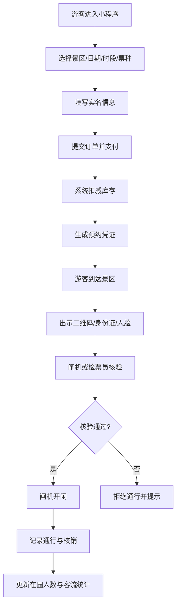

# 景区预约管理及门禁联动系统 PRD

## 1\. 文档信息

| 项目     | 内容                                                         |
| -------- | ------------------------------------------------------------ |
| 项目名称 | 景区预约管理及门禁联动系统                                   |
| 文档类型 | 产品需求文档（PRD）                                          |
| 版本     | V1.0                                                         |
| 适用阶段 | 立项、设计、开发、测试、验收                                 |
| 包含端   | 用户端小程序、后台管理系统、数据看板、门禁闸机联动模块       |
| 核心流程 | 预约、支付、核销、通行、客流统计、预警                       |
| 技术栈   | uni-app + JavaScript + MySQL，补全 Node.js、Redis、MQTT/WebSocket、闸机 SDK/HTTP/TCP |
| 部署方式 | 云服务器 + Nginx + Docker，可选 Kubernetes                   |
| 文档状态 | 初稿，可用于需求评审                                         |

---

## 2\. 项目背景与目标

### 2.1 项目背景

景区目前存在以下问题：

-   游客现场排队购票、换票、核销效率低；
    
-   预约、核销、入园、出园数据分散，无法实时统计；
    
-   客流高峰缺乏限流和预警手段；
    
-   闸机与票务系统割裂，无法自动核销和开闸；
    
-   财务对账、渠道统计、退改签管理困难。
    

### 2.2 项目目标

建设一套覆盖“预约—核销—通行—统计”全流程的景区预约管理与门禁联动系统，实现：

-   游客线上分时预约、实名登记、扫码/刷证/人脸通行；
    
-   后台统一管理票种、库存、订单、核销、设备和权限；
    
-   数据看板实时展示预约、核销、在园、客流、设备状态；
    
-   门禁闸机自动核验、开闸、计数、告警和离线容灾；
    
-   支持限流、预警、应急放行和财务对账。
    

### 2.3 核心 KPI

| 指标         | 目标                                     |
| ------------ | ---------------------------------------- |
| 核销效率     | 单次核销 < 500ms                         |
| 开闸响应     | 核验通过到开闸 < 1s                      |
| 数据看板延迟 | 实时数据 < 5s                            |
| 预约并发     | 支持 1000+ 并发预约，视景区规模扩展      |
| 闸机在线率   | ≥ 99%                                    |
| 离线通行     | 断网后可离线核销，恢复后自动同步         |
| 对账准确率   | 订单、核销、通行、财务数据一致率 ≥ 99.9% |

---

## 3\. 技术栈补全

### 3.1 用户端小程序

-   框架：uni-app + Vue3 + JavaScript
    
-   UI：uni-ui / uView
    
-   编译目标：微信小程序、支付宝小程序、H5，可选抖音小程序
    
-   功能：预约、支付、订单、凭证二维码、消息通知、个人中心
    

### 3.2 后台管理系统

-   框架：Vue3 + JavaScript + Vite
    
-   UI：Element Plus
    
-   图表：ECharts
    
-   功能：景区、票种、库存、订单、核销、闸机、权限、财务、日志
    

### 3.3 服务端

-   语言：Node.js + JavaScript
    
-   框架：NestJS / Express
    
-   接口：RESTful API + JWT
    
-   文档：Swagger / Apifox
    
-   定时任务：Node-Cron / BullMQ
    
-   实时通信：WebSocket / MQTT
    

### 3.4 数据与中间件

-   主数据库：MySQL 8.0
    
-   缓存：Redis，用于库存扣减、分布式锁、验证码、会话、热点数据
    
-   消息队列：RabbitMQ / Redis Stream / Kafka，可选
    
-   对象存储：阿里云 OSS / 腾讯云 COS
    
-   短信/支付：微信支付、支付宝、短信服务商
    

### 3.5 门禁闸机联动

-   对接方式：HTTP/JSON、MQTT、TCP、厂商 SDK
    
-   读头类型：二维码、身份证、人脸、IC 卡
    
-   控制方式：继电器开闸、串口指令、网络指令
    
-   传感设备：红外对射、光幕、地感
    
-   建议优先选择支持 HTTP/MQTT 的闸机，降低集成难度
    

---

## 4\. 用户角色与权限

| 角色       | 说明         | 主要权限                               |
| ---------- | ------------ | -------------------------------------- |
| 游客       | 小程序用户   | 预约、支付、查看订单、出示凭证、退改   |
| 检票员     | 现场核销人员 | 扫码核销、PDA 核销、人工放行、查询订单 |
| 景区管理员 | 景区运营人员 | 票种、库存、订单、核销、设备、内容管理 |
| 财务       | 财务人员     | 对账、退款审核、报表导出               |
| 运维       | 设备运维     | 闸机监控、远程控制、告警处理           |
| 领导       | 管理层       | 数据看板、经营分析                     |
| 超级管理员 | 系统管理员   | 组织、角色、权限、参数、日志、备份     |

---

## 5\. 核心业务流程

### 5.1 总体流程

### 5.2 订单状态机

-   待支付
    
-   已支付 / 待核销
    
-   部分核销
    
-   已核销
    
-   已取消
    
-   已退款
    
-   已过期
    

### 5.3 预约状态机

-   待使用
    
-   已使用
    
-   已取消
    
-   已过期
    
-   已改签
    

### 5.4 通行状态机

-   入园成功
    
-   出园成功
    
-   拒绝通行
    
-   异常告警
    
-   应急放行
    

---

## 6\. 功能需求

## 6.1 用户端小程序

### 6.1.1 首页

| 编号  | 功能      | 说明                                     | 优先级 |
| ----- | --------- | ---------------------------------------- | ------ |
| U-001 | 景区展示  | 展示景区名称、图片、简介、开放时间、公告 | P0     |
| U-002 | 快捷预约  | 一键进入预约页                           | P0     |
| U-003 | 我的订单  | 查看待使用、已使用、已取消订单           | P0     |
| U-004 | 消息通知  | 预约成功、核销成功、退款、预警通知       | P1     |
| U-005 | 客服/帮助 | 常见问题、电话、在线客服                 | P2     |

### 6.1.2 预约购票

| 编号  | 功能     | 说明                                   | 优先级 |
| ----- | -------- | -------------------------------------- | ------ |
| U-010 | 选择日期 | 日历展示可预约日期、余票、价格         | P0     |
| U-011 | 选择时段 | 分时预约，如 08:00-10:00               | P0     |
| U-012 | 选择票种 | 成人票、儿童票、老人票、学生票、团体票 | P0     |
| U-013 | 实名信息 | 姓名、身份证、手机号，支持同行人       | P0     |
| U-014 | 限购规则 | 每账号/身份证限购数量                  | P0     |
| U-015 | 库存校验 | 实时校验余票，防止超卖                 | P0     |
| U-016 | 支付     | 微信支付、支付宝、免费预约             | P0     |
| U-017 | 退改规则 | 展示退改时间、手续费、不可退票种       | P1     |
| U-018 | 预约须知 | 入园规则、证件要求、安全提示           | P1     |

### 6.1.3 订单与凭证

| 编号  | 功能       | 说明                                     | 优先级 |
| ----- | ---------- | ---------------------------------------- | ------ |
| U-020 | 订单列表   | 全部、待使用、已使用、已取消、退款       | P0     |
| U-021 | 订单详情   | 景区、票种、日期、时段、游客、金额、状态 | P0     |
| U-022 | 电子凭证   | 动态二维码，每分钟刷新，防截屏           | P0     |
| U-023 | 身份证通行 | 绑定身份证，支持刷证入园                 | P1     |
| U-024 | 人脸录入   | 可选，用于人脸识别通行                   | P2     |
| U-025 | 申请退款   | 按规则退款，后台审核                     | P1     |
| U-026 | 改签       | 支持日期/时段改签，视库存和规则          | P2     |
| U-027 | 发票申请   | 电子发票                                 | P2     |

### 6.1.4 个人中心

| 编号  | 功能       | 说明                 | 优先级 |
| ----- | ---------- | -------------------- | ------ |
| U-030 | 登录注册   | 微信授权、手机号绑定 | P0     |
| U-031 | 游客管理   | 常用游客、同行人     | P0     |
| U-032 | 我的预约   | 历史预约记录         | P0     |
| U-033 | 黑名单提示 | 被限制预约时提示原因 | P1     |
| U-034 | 设置       | 隐私、通知、注销     | P2     |

---

## 6.2 后台管理系统

### 6.2.1 工作台

-   今日预约、核销、入园、出园、在园、收入
    
-   待处理退款、待审核改签、设备告警
    
-   快捷入口：订单、核销、闸机、看板
    

### 6.2.2 景区管理

| 编号  | 功能     | 说明                             | 优先级 |
| ----- | -------- | -------------------------------- | ------ |
| A-001 | 景区信息 | 名称、地址、开放时间、最大承载量 | P0     |
| A-002 | 公告管理 | 发布、编辑、下架公告             | P1     |
| A-003 | 入园须知 | 富文本配置                       | P1     |
| A-004 | 地图点位 | 闸机、售票处、入口位置           | P2     |

### 6.2.3 票种与库存

| 编号  | 功能     | 说明                           | 优先级 |
| ----- | -------- | ------------------------------ | ------ |
| A-010 | 票种管理 | 名称、价格、适用人群、退改规则 | P0     |
| A-011 | 价格日历 | 平日、周末、节假日不同价格     | P0     |
| A-012 | 分时库存 | 每个时段库存、已售、锁定、剩余 | P0     |
| A-013 | 库存调整 | 手动增减库存，记录操作日志     | P0     |
| A-014 | 限购规则 | 按账号、身份证、手机号限购     | P0     |
| A-015 | 渠道库存 | 分配各渠道库存                 | P1     |

### 6.2.4 订单管理

| 编号  | 功能     | 说明                             | 优先级 |
| ----- | -------- | -------------------------------- | ------ |
| A-020 | 订单列表 | 多条件筛选、导出                 | P0     |
| A-021 | 订单详情 | 游客、票种、支付、核销、通行记录 | P0     |
| A-022 | 退款审核 | 同意/拒绝、退款原因、原路退回    | P0     |
| A-023 | 改签审核 | 审核改签请求                     | P1     |
| A-024 | 异常订单 | 支付超时、重复支付、库存异常     | P0     |
| A-025 | 团体订单 | 批量导入、批量核销               | P1     |

### 6.2.5 核销管理

| 编号  | 功能         | 说明                         | 优先级 |
| ----- | ------------ | ---------------------------- | ------ |
| A-030 | 扫码核销     | 小程序/PDA 扫描凭证          | P0     |
| A-031 | 手动核销     | 输入订单号/身份证后四位      | P0     |
| A-032 | 部分核销     | 多人订单分次核销             | P1     |
| A-033 | 重复核销提示 | 已核销凭证再次核销告警       | P0     |
| A-034 | 核销记录     | 时间、人员、闸机、订单、结果 | P0     |
| A-035 | 离线核销     | 断网时本地核销，恢复后同步   | P1     |

### 6.2.6 通行管理

| 编号  | 功能     | 说明                          | 优先级 |
| ----- | -------- | ----------------------------- | ------ |
| A-040 | 通行记录 | 入园、出园、拒绝、异常        | P0     |
| A-041 | 在园人数 | 实时计算：累计入园 - 累计出园 | P0     |
| A-042 | 应急放行 | 管理员远程常开/放行           | P0     |
| A-043 | 黑名单   | 禁止预约/通行人员             | P1     |
| A-044 | 通行规则 | 时段、票种、闸机权限          | P0     |

### 6.2.7 闸机设备管理

| 编号  | 功能      | 说明                           | 优先级 |
| ----- | --------- | ------------------------------ | ------ |
| A-050 | 设备列表  | 闸机编号、位置、IP、状态       | P0     |
| A-051 | 心跳监控  | 在线、离线、最后心跳           | P0     |
| A-052 | 远程控制  | 开闸、常开、常闭、重启         | P0     |
| A-053 | 设备日志  | 开闸、拒绝、故障、操作日志     | P0     |
| A-054 | 告警管理  | 离线、尾随、强行通过、消防联动 | P0     |
| A-055 | 固件/配置 | 参数下发、版本管理             | P2     |

### 6.2.8 财务与对账

| 编号  | 功能     | 说明                   | 优先级 |
| ----- | -------- | ---------------------- | ------ |
| A-060 | 收入统计 | 按票种、渠道、日期统计 | P0     |
| A-061 | 退款统计 | 退款金额、原因、审核人 | P0     |
| A-062 | 渠道对账 | 微信、支付宝、OTA 对账 | P1     |
| A-063 | 导出报表 | Excel/CSV              | P0     |

### 6.2.9 系统管理

| 编号  | 功能     | 说明                         | 优先级 |
| ----- | -------- | ---------------------------- | ------ |
| A-070 | 组织管理 | 景区、部门、岗位             | P0     |
| A-071 | 角色权限 | 菜单、按钮、数据权限         | P0     |
| A-072 | 操作日志 | 登录、修改、导出、核销       | P0     |
| A-073 | 数据字典 | 票种、状态、渠道             | P1     |
| A-074 | 参数配置 | 预约规则、退改规则、预警阈值 | P0     |
| A-075 | 数据备份 | 定时备份、恢复               | P1     |

---

## 6.3 数据看板

### 6.3.1 实时大屏

| 指标          | 说明                 |
| ------------- | -------------------- |
| 当前在园人数  | 实时更新             |
| 今日预约人数  | 按票种、时段         |
| 今日核销人数  | 已核销/总预约        |
| 今日入园/出园 | 分时趋势             |
| 承载率        | 在园/最大承载量      |
| 闸机在线率    | 在线/总数            |
| 告警数量      | 离线、尾随、强行通过 |
| 渠道来源      | 小程序、OTA、窗口    |

### 6.3.2 运营分析

-   预约趋势：7 天、30 天、自定义
    
-   核销率：预约核销率、退单率、爽约率
    
-   客流分析：分时客流、日客流、月客流
    
-   客源分析：地域、年龄、性别
    
-   票种分析：销量、收入、占比
    
-   渠道分析：各渠道订单、核销、佣金
    
-   财务分析：收入、退款、实收
    

### 6.3.3 预警看板

-   承载量预警：达到 80%、90%、100% 分级告警
    
-   时段拥堵预警：某时段预约/核销过高
    
-   设备预警：闸机离线、故障
    
-   异常预警：重复核销、尾随、黑名单尝试通行
    

---

## 6.4 门禁闸机联动模块

### 6.4.1 核验方式

| 方式     | 说明                         | 优先级 |
| -------- | ---------------------------- | ------ |
| 二维码   | 小程序动态码，闸机扫码头读取 | P0     |
| 身份证   | 身份证读头读取，匹配预约     | P0     |
| 人脸     | 人脸识别终端，1:N 或 1:1     | P2     |
| IC 卡    | 员工卡、年卡                 | P2     |
| 手工放行 | 检票员远程/本地放行          | P0     |

### 6.4.2 联动流程

1.  闸机读头读取凭证；
    
2.  闸机调用核验接口，上传凭证、闸机编号、方向；
    
3.  服务端校验：
    
    -   凭证签名、有效期；
        
    -   预约日期、时段；
        
    -   票种、人数、剩余核销次数；
        
    -   是否已核销、是否黑名单；
        
    -   闸机权限、方向权限；
    
4.  校验通过，返回开闸指令；
    
5.  闸机开闸，记录通行；
    
6.  服务端更新核销、在园人数、客流统计；
    
7.  校验失败，闸机语音/屏幕提示，记录拒绝通行。
    

### 6.4.3 开闸指令要求

-   指令需签名、时间戳、随机数，防重放；
    
-   支持幂等：同一请求多次到达只开闸一次；
    
-   超时重试：3 次，间隔 500ms；
    
-   开闸超时：3s 未反馈则告警；
    
-   远程控制：常开、常闭、单次开闸。
    

### 6.4.4 离线模式

-   闸机本地缓存预约白名单、黑名单、票种规则；
    
-   断网时本地核验，允许通行并记录；
    
-   网络恢复后自动上传离线记录；
    
-   服务端冲突处理：以首次核销为准，异常记录人工审核。
    

### 6.4.5 防尾随与安全

-   红外/光幕检测尾随；
    
-   双向计数：入园、出园；
    
-   强行通过告警；
    
-   消防联动：火灾信号自动常开；
    
-   应急放行：管理员远程开闸并记录。
    

### 6.4.6 客流统计

-   在园人数 = 累计入园 - 累计出园；
    
-   分时入园/出园；
    
-   时段客流、日客流、月客流；
    
-   承载量预警；
    
-   客流热力图可选。
    

---

## 7\. 数据模型（核心表）

| 表名            | 说明        | 关键字段                                                     |
| --------------- | ----------- | ------------------------------------------------------------ |
| user            | 用户        | id, openid, phone, nickname, status                          |
| visitor         | 游客/同行人 | id, user\_id, name, id\_card, phone                          |
| scenic\_area    | 景区        | id, name, address, max\_capacity, open\_time                 |
| ticket\_type    | 票种        | id, area\_id, name, price, rules                             |
| ticket\_stock   | 库存        | id, ticket\_type\_id, date, time\_slot, total, sold, locked  |
| order           | 订单        | id, order\_no, user\_id, amount, status, pay\_time           |
| order\_item     | 订单明细    | id, order\_id, visitor\_id, ticket\_type\_id, status         |
| reservation     | 预约        | id, order\_id, date, time\_slot, status, qr\_code            |
| verification    | 核销        | id, reservation\_id, verify\_time, channel, operator         |
| passage\_record | 通行记录    | id, reservation\_id, gate\_id, direction, result, time       |
| gate\_device    | 闸机        | id, name, location, ip, status, last\_heartbeat              |
| gate\_log       | 闸机日志    | id, gate\_id, action, request, response, time                |
| blacklist       | 黑名单      | id, id\_card, phone, reason, expire\_time                    |
| admin\_user     | 管理员      | id, username, password, role\_id, status                     |
| role            | 角色        | id, name, permissions                                        |
| daily\_stats    | 日统计      | id, date, reservations, verifications, in\_count, out\_count |
| alarm           | 告警        | id, type, gate\_id, level, status, time                      |

---

## 8\. 接口需求（示例）

### 8.1 小程序接口

| 方法 | 路径              | 说明         |
| ---- | ----------------- | ------------ |
| GET  | /api/mini/areas   | 景区列表     |
| GET  | /api/mini/tickets | 票种列表     |
| GET  | /api/mini/stocks  | 库存查询     |
| POST | /api/mini/orders  | 创建订单     |
| POST | /api/mini/pay     | 发起支付     |
| GET  | /api/mini/orders  | 订单列表     |
| GET  | /api/mini/qrcode  | 获取动态凭证 |
| POST | /api/mini/refund  | 申请退款     |

### 8.2 后台接口

| 方法 | 路径                          | 说明     |
| ---- | ----------------------------- | -------- |
| POST | /api/admin/login              | 登录     |
| GET  | /api/admin/orders             | 订单列表 |
| POST | /api/admin/verify             | 核销     |
| GET  | /api/admin/gates              | 闸机列表 |
| POST | /api/admin/gate/open          | 远程开闸 |
| GET  | /api/admin/dashboard/realtime | 实时看板 |
| GET  | /api/admin/stats/daily        | 日统计   |

### 8.3 闸机接口

| 方法 | 路径                   | 说明         |
| ---- | ---------------------- | ------------ |
| POST | /api/gate/verify       | 凭证核验     |
| POST | /api/gate/heartbeat    | 心跳上报     |
| POST | /api/gate/passage      | 通行记录上报 |
| POST | /api/gate/alarm        | 告警上报     |
| POST | /api/gate/offline/sync | 离线记录同步 |

---

## 9\. 非功能需求

### 9.1 性能

-   核销接口响应 < 500ms；
    
-   开闸指令响应 < 1s；
    
-   看板数据延迟 < 5s；
    
-   支持 1000+ 并发预约，可水平扩展；
    
-   数据库读写分离、Redis 缓存热点库存。
    

### 9.2 安全

-   HTTPS 全站加密；
    
-   JWT + RBAC 权限；
    
-   动态二维码，防截屏、防重放；
    
-   身份证、手机号脱敏存储；
    
-   接口签名、限流、防刷；
    
-   操作日志不可篡改；
    
-   符合《个人信息保护法》和景区实名制要求。
    

### 9.3 可用性

-   系统可用性 ≥ 99.9%；
    
-   闸机离线可用；
    
-   数据库主从/定时备份；
    
-   关键服务降级：核销优先，报表可延迟。
    

### 9.4 兼容性

-   小程序兼容微信、支付宝；
    
-   后台兼容 Chrome、Edge；
    
-   闸机兼容主流厂商 HTTP/MQTT/TCP/SDK。
    

### 9.5 可扩展

-   支持多景区、多入口、多闸机；
    
-   支持 OTA 渠道接入；
    
-   支持人脸、数字人民币、会员体系扩展。
    

---

## 10\. 异常与风控

| 场景       | 处理                                  |
| ---------- | ------------------------------------- |
| 库存超卖   | Redis 预减 + MySQL 乐观锁 + 对账修复  |
| 重复核销   | 唯一索引 + 状态机 + 告警              |
| 支付超时   | 15 分钟未支付自动取消，释放库存       |
| 闸机离线   | 本地缓存核验，恢复后同步              |
| 网络抖动   | 开闸指令重试 + 幂等                   |
| 黄牛刷票   | 限购、风控、黑名单、验证码            |
| 尾随       | 红外检测 + 告警 + 视频联动可选        |
| 消防报警   | 自动常开，记录应急放行                |
| 数据不一致 | 定时对账，订单/核销/通行/财务四表核对 |

---

## 11\. 验收标准

1.  游客可完成预约、支付、查看凭证、退款申请；
    
2.  后台可管理景区、票种、库存、订单、核销、闸机、权限；
    
3.  数据看板实时展示在园、预约、核销、客流、设备状态；
    
4.  闸机可识别二维码/身份证，核验通过后 1s 内开闸；
    
5.  断网时闸机可离线核销，恢复后数据同步；
    
6.  重复核销、黑名单、尾随、强行通过可告警；
    
7.  订单、核销、通行、财务数据一致；
    
8.  性能、安全、合规满足第 9 节要求；
    
9.  提供完整接口文档、部署文档、操作手册、测试报告。
    

---

## 12\. 迭代计划

| 阶段 | 内容                                                         | 周期建议 |
| ---- | ------------------------------------------------------------ | -------- |
| 一期 | 用户端预约、支付、订单、凭证；后台票种、库存、订单、核销；基础闸机 HTTP 联动 | 6-8 周   |
| 二期 | 数据看板、客流统计、闸机离线、告警、财务对账                 | 4-6 周   |
| 三期 | 人脸识别、身份证通行、OTA 渠道、会员、应急指挥               | 4-6 周   |
| 四期 | 智能推荐、热力图、AI 客流预测、多景区 SaaS 化                | 按需     |

---

## 13\. 风险与依赖

| 风险           | 说明                | 应对                             |
| -------------- | ------------------- | -------------------------------- |
| 闸机协议不统一 | 不同厂商接口差异大  | 优先选 HTTP/MQTT，抽象设备适配层 |
| 网络不稳定     | 景区山区/地下信号差 | 离线核销 + 本地缓存              |
| 高并发超卖     | 节假日抢票          | Redis + 队列 + 限流              |
| 黄牛倒票       | 实名制被绕过        | 人脸、限购、风控、黑名单         |
| 数据合规       | 身份证、人脸敏感    | 加密、脱敏、授权、审计           |
| 消防联动       | 安全要求            | 与消防系统对接，常开优先         |

---

## 14\. 权限矩阵（简版）

| 功能     | 游客 | 检票员 | 景区管理员 | 财务 | 运维 | 超管 |
| -------- | ---- | ------ | ---------- | ---- | ---- | ---- |
| 预约     | ✅    | ❌      | ❌          | ❌    | ❌    | ✅    |
| 核销     | ❌    | ✅      | ✅          | ❌    | ❌    | ✅    |
| 订单查看 | 本人 | ✅      | ✅          | ✅    | ❌    | ✅    |
| 退款审核 | ❌    | ❌      | ✅          | ✅    | ❌    | ✅    |
| 闸机控制 | ❌    | ❌      | ✅          | ❌    | ✅    | ✅    |
| 数据看板 | ❌    | ❌      | ✅          | ✅    | ✅    | ✅    |
| 系统管理 | ❌    | ❌      | ❌          | ❌    | ❌    | ✅    |

---

## 15\. 结论

本 PRD 覆盖了景区预约管理及门禁联动系统的完整业务闭环：

**用户端小程序 → 后台管理 → 数据看板 → 门禁闸机联动 → 预约/核销/通行/客流统计**。

技术栈以 `uni-app + JavaScript + MySQL` 为核心，补全 `Node.js、Redis、MQTT/WebSocket、闸机 HTTP/TCP/SDK` 后，可支撑高并发、离线容灾、实时看板和硬件联动。